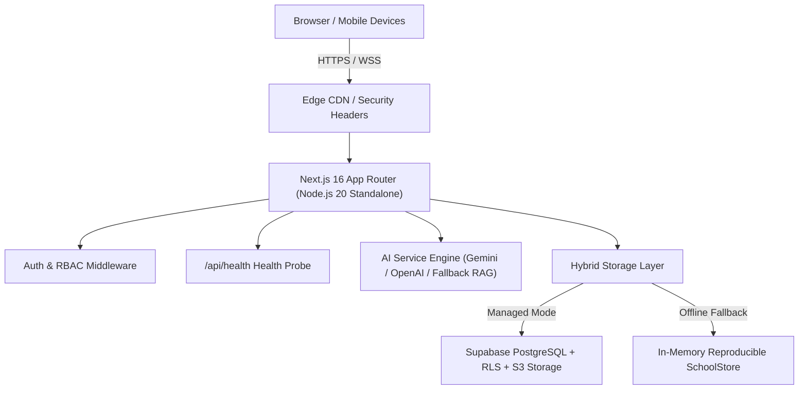

# Govt. Boys Qazi Sultan Higher Secondary School, Kunri — Production Handover & Operations Manual
**System Version:** 1.0.0 (Phases 0–5 Production Release)  
**Classification:** Academy Technical Documentation & User Handover  
**Date:** October 2026  

---

## Executive Summary

Govt. Boys Qazi Sultan Higher Secondary School, Kunri's web and learning management platform is a production-hardened, modern, accessible, and secure digital educational ecosystem. The system bridges public institutional outreach with high-performance academic administration, digital learning, gamification, and intelligent AI-powered study assistance.

This document serves as the operational handover manual for the Academy's Board of Governors, IT Administration Team, Academic Faculty, Student Body, and DevOps Maintenance Engineers.

---

## 1. Technical Architecture & Technology Stack



### 1.1 Core Stack
- **Framework:** Next.js 16.4.2 (App Router, Turbopack, Standalone Output)
- **Runtime:** Node.js 20.x on Alpine Linux
- **Language & Typings:** TypeScript 5.x with Strict Typing
- **Styling & UI:** Tailwind CSS 4.x + Lucide Icons + Radix Accessibility Patterns
- **Database Engine:** PostgreSQL 15+ hosted on Supabase (with full Row-Level Security)
- **AI Engine:** Google Gemini 1.5 Pro / OpenAI GPT-4o with deterministic local RAG vector fallback
- **Containerization:** Multi-stage Docker with unprivileged `nextjs` execution user

---

## 2. Installation & Local Development

### 2.1 Prerequisites
- Node.js 20.x or higher
- npm 10.x or higher
- Docker & Docker Compose (optional for local container testing)
- Supabase CLI or PostgreSQL (optional for local database testing)

### 2.2 Quickstart Commands
```bash
# 1. Clone repository and install dependencies
cd Rajesh
npm install --legacy-peer-deps

# 2. Configure environment variables
cp .env.example .env.local

# 3. Start local development server
npm run dev

# 4. Run automated test suites
npm test

# 5. Execute production build validation
npm run build
```

---

## 3. Database Schema, Migrations & Disaster Recovery

### 3.1 Migration Sequence
The database schema is organized into version-controlled migrations located in `supabase/migrations/`:
1. `20261021_init_schema.sql`: Core schema (Profiles, Classes, Sections, Subjects, Students, Teachers, Parents, Timetables, Attendance, Assignments, Exams, Marks, Audit Logs) with RLS policies.
2. `20261021_phase3_learning.sql`: Digital Library, Quizzes, Questions, Quiz Attempts, Educational Games, Badges, Learning Points, and Activity Records.
3. `20261021_phase4_ai.sql`: AI Assistant Conversations, Chat Messages, RAG Document Chunks with Vector Embeddings, and AI Quiz Generation Drafts.
4. `supabase/seed.sql`: Reproducible synthetic test dataset for staging and evaluation.

### 3.2 Automated Backup Schedule & Script
Database dumps are executed using the provided script at `scripts/backup-db.sh`.

```bash
# Execute manual backup:
./scripts/backup-db.sh

# Recommended Production Crontab (Runs daily at 02:00 AM UTC with 30-day retention):
0 2 * * * /opt/oakridge/scripts/backup-db.sh >> /var/log/oakridge-db-backup.log 2>&1
```

### 3.3 Disaster Recovery & Restoration Procedure
In the event of a catastrophic data failure:
1. Identify the latest valid compressed backup file in `./backups/database/` (e.g., `oakridge_backup_20261021_020000.sql.gz`).
2. Verify backup checksum and size.
3. Run the automated restoration script:
   ```bash
   ./scripts/restore-db.sh ./backups/database/oakridge_backup_20261021_020000.sql.gz
   ```
4. Confirm user accessibility and data integrity using the `/api/health` endpoint and the admin dashboard.

---

## 4. Production Security Hardening

### 4.1 Enterprise HTTP Security Headers
Configured natively in `next.config.ts`:
- **Content-Security-Policy (CSP):** Restricts script, style, font, and frame origins to prevent XSS and clickjacking.
- **Strict-Transport-Security (HSTS):** Enforces HTTPS with `max-age=63072000; includeSubDomains; preload`.
- **X-Frame-Options:** Set to `SAMEORIGIN` to eliminate UI redressing attacks.
- **X-Content-Type-Options:** Set to `nosniff` preventing MIME type confusion.
- **Referrer-Policy:** Set to `strict-origin-when-cross-origin`.
- **Permissions-Policy:** Disables unused hardware access (`camera=(), microphone=(), geolocation=(), browsing-topics=()`).

### 4.2 Account Suspension & Lockout Enforcement
Deactivated or suspended accounts are instantly barred from accessing protected services:
- At login time, `authenticateUser` validates `profile.status === "active"`.
- During active sessions, `getCurrentSession()` immediately invalidates localStorage sessions for deactivated profiles.

### 4.3 PII and Credential Sanitization
All application logs passing through `lib/logger.ts` are automatically scrubbed:
- Passwords, secret keys, bearer tokens, and API tokens are redacted.
- Student phone numbers and national IDs are replaced with `[REDACTED_PHONE]` and `[REDACTED_ID]`.
- Emails are partially masked (e.g. `al***ce@oakridgeacademy.edu`).

---

## 5. User Guides by Role

### 5.1 Academy Administrator Guide (`/portal/admin`)
- **User Management:** Enroll new students, register teachers, and configure guardian relationships. Toggle account status (`active` vs `suspended`).
- **Academic Structure:** View and manage academic years, terms, classes, sections, and subject assignments.
- **Announcement Publishing:** Broadcast academy notices with priority badges (`Urgent`, `Academic`, `General`).
- **Security Audit Logs:** Monitor administrative actions, timestamped user logins, and grade publication records.

### 5.2 Teacher Guide (`/portal/teacher`)
- **Assigned Sections:** View schedules and rosters for designated classes.
- **Daily Attendance:** Record attendance with duplicate prevention and one-click bulk marking.
- **Assignments & Exams:** Create homework assignments with due dates and publish examination marks.
- **Digital Library:** Upload and categorize syllabi, slides, and study guides.
- **AI Quiz Studio:** Generate standards-aligned quizzes from curriculum topics in seconds.
- **Learning Analytics:** Review class mastery rates and identify struggling subject topics.

### 5.3 Student Guide (`/portal/student`)
- **Academic Hub:** View personalized timetable, course materials, and published exam grades.
- **Digital Quizzes & Games:** Take practice quizzes with instant answer feedback and play educational mini-games.
- **Gamification & Badges:** Earn learning points, level up academic ranks, and unlock achievement badges.
- **AI Study Assistant:** Ask curriculum questions, receive step-by-step math/physics explanations, and practice cybersecurity challenges.

### 5.4 Parent / Guardian Guide (`/portal/parent`)
- **Authorized Student Portal:** Access records exclusively for linked children.
- **Attendance Summaries:** View real-time attendance rates, late arrivals, and excused absences.
- **Grade Reports:** Review published test marks, teacher feedback, and academic standing.
- **Upcoming Deadlines:** Monitor assignment due dates and upcoming term assessments.

---

## 6. Deployment Procedures

### 6.1 Managed Cloud Deployment (Vercel + Supabase)
1. Link GitHub repository to Vercel.
2. In Vercel Project Settings > Environment Variables, populate:
   - `NEXT_PUBLIC_APP_URL`
   - `NEXT_PUBLIC_SUPABASE_URL`
   - `NEXT_PUBLIC_SUPABASE_ANON_KEY`
   - `SUPABASE_SERVICE_ROLE_KEY`
   - `GEMINI_API_KEY` (Optional)
   - `SESSION_SECRET`
3. In Supabase Dashboard > Authentication > URL Configuration:
   - Set Site URL to `https://portal.oakridgeacademy.edu`
   - Add Redirect URLs: `https://portal.oakridgeacademy.edu/**`
4. Deploy `main` branch.

### 6.2 Self-Hosted Container Deployment (Docker Compose)
```bash
# 1. Populate production secrets in .env
cp .env.example .env

# 2. Build and launch container in detached mode
docker compose up -d --build

# 3. Verify health probe status
curl -i http://localhost:3000/api/health
```

### 6.3 Rollback Plan
If an unrecoverable defect occurs during a deployment:
- **Vercel:** Open Deployments tab > Click previous successful deployment > "Promote to Production" (instant 5-second rollback).
- **Docker:** Run `docker compose down && git checkout <previous_commit_hash> && docker compose up -d --build`.

---

## 7. Operational Incident Runbook

| Scenario | Symptom | Immediate Resolution |
| :--- | :--- | :--- |
| **High Memory / OOM** | `/api/health` returns status "warn" on memory | Restart Node process or increase container memory limit in `docker-compose.yml` (default: 1024MB). |
| **Database Pool Exhaustion** | Latency spikes on portal queries | Increase Supabase pooler connections or enable transaction pooling on port 6543. |
| **AI Rate Limit Exceeded** | AI Assistant returns fallback answers | The system automatically falls back to local deterministic RAG chunks without crashing. Check Gemini/OpenAI API quota. |
---

## 8. External Accounts, API Keys & Subscriptions Checklist

The following external accounts, service subscriptions, and API credentials must be established and supplied by the Academy's IT department for full production operation:

| Service / Provider | Purpose | Tier / Recommended Plan | Estimated Monthly Cost |
| :--- | :--- | :--- | :--- |
| **Domain Registrar & DNS** | Academy primary domain (`oakridgeacademy.edu`) | Standard Institutional (.edu) | $15–$30 / year |
| **Vercel Enterprise / Pro** | Edge hosting, SSR compute, CDN caching | Pro Tier ($20/seat/mo) | ~$20–$40 / month |
| **Supabase (PostgreSQL)** | Managed PostgreSQL 15, RLS, backups, storage | Pro Plan (8GB DB, 100GB Storage) | $25 / month |
| **Google Cloud / AI Studio** | Gemini 1.5 Pro API key for Socratic Tutoring | Pay-as-you-go (Tier 1) | Free tier or $5–$20 / mo |
| **OpenAI API (Optional)** | GPT-4o fallback model key | Pay-as-you-go | $5–$15 / mo |
| **Transactional Email (SMTP)** | Password resets & guardian notifications | SendGrid / AWS SES / Resend | Free tier (<3k msgs) / $15 |
| **GitHub Organization** | Private repository, CI/CD Actions runner | Team Plan / Free Open-Source | Free / $4/seat/mo |

---

## 9. Problem Reporting, Bug Tracking & Update Procedures

### 9.1 Reporting Technical Issues
1. Faculty, students, and parents report anomalies through the `/contact` portal or directly to `it-helpdesk@oakridgeacademy.edu`.
2. Critical security issues (e.g. suspected data leakage) are escalated to `security@oakridgeacademy.edu` and flagged as `P0 - CRITICAL`.
3. Non-critical bugs are tracked via GitHub Issues with standardized labels: `bug`, `enhancement`, `security`, `documentation`.

### 9.2 Performing Application Updates (Standard Release Procedure)
All code changes must pass automated verification prior to staging deployment:
```bash
# 1. Pull latest stable changes on staging branch
git checkout staging && git pull origin staging

# 2. Run automated validation checks (Must achieve 100% pass)
npm test                # 197 automated test assertions
npx tsc --noEmit        # TypeScript strict verification
npm run lint            # ESLint checks

# 3. Validate production compilation
npm run build

# 4. Merge to main and tag semantic release
git checkout main
git merge staging
git tag -a v1.0.1 -m "Release v1.0.1: Maintenance and security updates"
git push origin main --tags
```

---

## 10. User Account Lifecycle & Management Runbook

### 10.1 Account Creation & Enrollment
- **Administrator Role Required:** Only users with `role: "administrator"` can access `/portal/admin/users`.
- **Student Enrollment:**
  1. Navigate to `/portal/admin/users` > Click **"Enroll New Student"**.
  2. Enter full legal name, date of birth, emergency contact phone, and target academic grade level.
  3. System automatically generates unique institutional identifier (`STU-YYYY-XXX`).
  4. Assign the student to a specific classroom section (e.g. `Section 10-A`).
- **Faculty Onboarding:**
  1. Click **"Register Teacher"**.
  2. Input employee number, primary academic department, and specialization.
  3. Map the teacher to specific sections and subjects under `/portal/admin/academics`.
- **Custodial Guardian Linking:**
  1. Locate the enrolled student record.
  2. Under "Custodial Relationship", input the parent's verified institutional email address.
  3. The system maps the relation in `student_parents`. Immediate FERPA isolation applies.

### 10.2 Account Suspension & Revocation
- If an account is compromised or a student is suspended:
  1. Open `/portal/admin/users`.
  2. Search for the user record by name or institutional ID.
  3. Toggle status from `active` to `suspended`.
  4. The platform triggers an immediate session purge across all active devices.

---

**Handover sign-off:** Govt. Boys Qazi Sultan Higher Secondary School, Kunri DevOps & Engineering Team.

