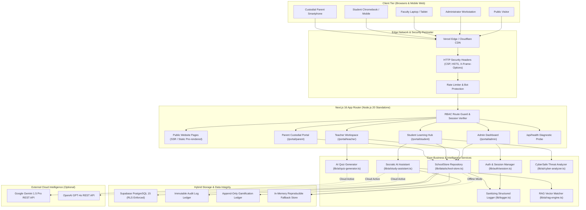
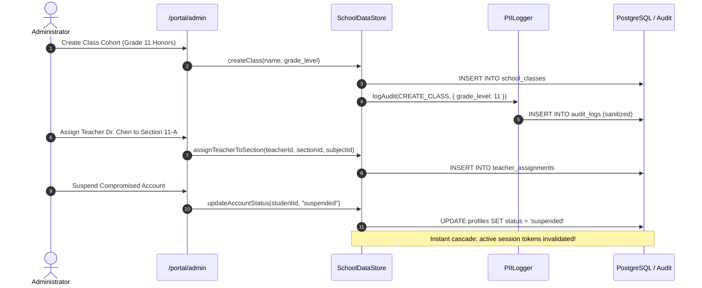
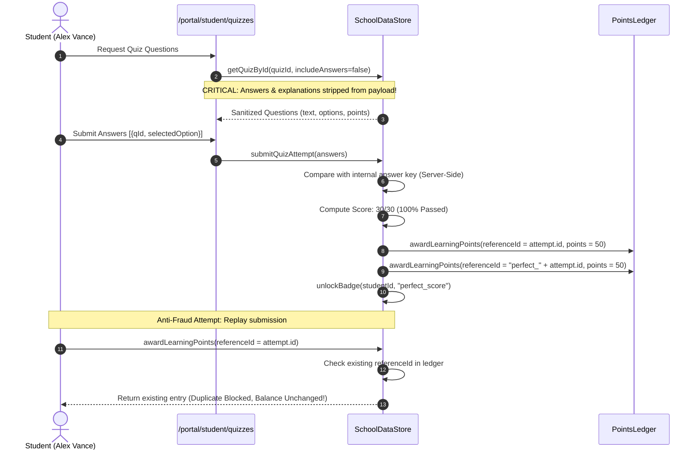
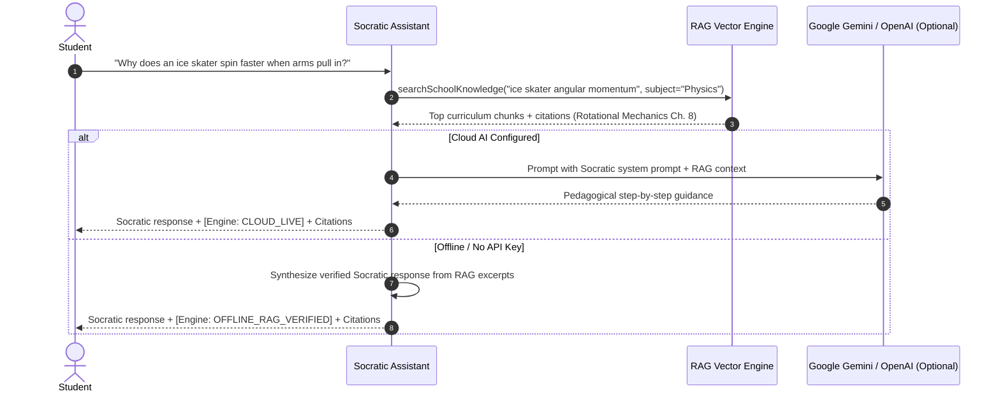
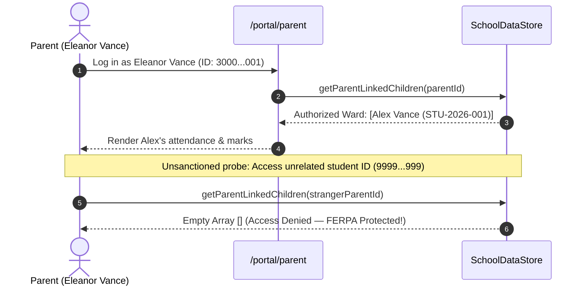

# Architecture Diagram & System Topography

**Document Reference:** `docs/competition/ARCHITECTURE_DIAGRAM.md`  
**Classification:** Competition Jury Technical Presentation Asset  
**Institution:** Oakridge Collegiate Academy  

---

## 1. High-Level Enterprise Topography

---

## 2. End-to-End Component Flow Diagrams

### Journey A: Administrator Academic Setup & Account Deactivation

### Journey B & C: Assessment Security & Anti-Fraud Points

### Journey D: Socratic RAG AI Tutoring

### Journey E: Custodial Parent Privacy Isolation

