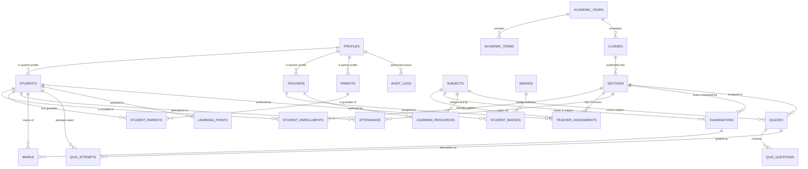

# Database Schema, Entity Relationships & Row-Level Security

**Document Reference:** `docs/competition/DATABASE_OVERVIEW.md`  
**Classification:** Competition Jury Technical Presentation Asset  
**Institution:** Oakridge Collegiate Academy  

---

## 1. Entity Relationship Diagram (ERD)



---

## 2. Table Inventory & Domain Structure

The database schema is organized across version-controlled migration files in `supabase/migrations/`:

### 2.1 Core Institutional Schema (`20261021_init_schema.sql`)
1. **`profiles`:** Base identity table extending `auth.users` (`id`, `email`, `full_name`, `role`, `status`, `phone`, `avatar_url`).
2. **`academic_years` & `academic_terms`:** Term governance (`start_date`, `end_date`, `is_current`).
3. **`school_classes` & `school_sections`:** Physical/cohort organization (`grade_level`, `capacity`, `room_number`).
4. **`school_subjects`:** Accredited courses (`code`, `name`, `department`, `credits`).
5. **`students`, `teachers`, `parents`:** Domain role extensions with institutional identifiers (`student_number`, `employee_number`).
6. **`student_parents`:** Custodial mapping table linking parents strictly to authorized wards with relationship types (`mother`, `father`, `legal_guardian`).
7. **`teacher_assignments`:** Scoped teaching authorizations linking teachers to sections and subjects.
8. **`student_enrollments`:** Section mappings with roll numbers and status tracking.
9. **`timetables`:** Weekly schedules (`day_of_week`, `start_time`, `end_time`, `room`).
10. **`attendance`:** Daily attendance records with date-scoped unique constraints preventing duplicate markings.
11. **`assignments` & `assignment_submissions`:** Coursework deadlines, student submissions, and teacher feedback.
12. **`examinations` & `marks`:** Summative tests, maximum marks, grade scales, and draft/published flags (`is_published`).
13. **`portal_announcements`:** Priority-tagged notices (`Urgent`, `Academic`, `General`) with targeted audience scoping.
14. **`audit_logs`:** Immutable record of all administrative and grade-altering transactions.

### 2.2 Digital Learning & Gamification Schema (`20261021_phase3_learning.sql`)
15. **`learning_resources`:** Syllabi, PDF study guides, lecture notes, with publication states and download tracking.
16. **`resource_bookmarks` & `recent_access_logs`:** Student repository interactions.
17. **`quizzes` & `quiz_questions`:** Timed interactive assessments with question types, order indices, points, and pass criteria.
18. **`quiz_attempts` & `quiz_attempt_answers`:** Timestamped student attempts with server-calculated scores and evaluated answers.
19. **`game_definitions` & `game_sessions`:** Educational games (CyberSafe Challenge, Topic Mastery) with accuracy logging.
20. **`badges` & `student_badges`:** Achievement definitions and earned honors with timestamps.
21. **`learning_points`:** Append-only ledger with `reference_id` integrity checks blocking duplicate claims.
22. **`learning_activities`:** Chronological activity stream for student and parent progress tracking.

### 2.3 Artificial Intelligence & Knowledge Schema (`20261021_phase4_ai.sql`)
23. **`ai_conversations` & `ai_messages`:** Multi-turn study assistant sessions with citations and follow-up prompts.
24. **`rag_documents` & `rag_document_chunks`:** Textbook and curriculum knowledge chunks with embedding vectors.
25. **`ai_quiz_drafts`:** AI-generated question proposals awaiting faculty review and publication.

---

## 3. Row-Level Security (RLS) Policy Highlights

PostgreSQL Row-Level Security ensures that unauthorized queries are blocked directly at the database engine level:

```sql
-- Example 1: Custodial Parent Isolation
-- Parents can ONLY select student records if an explicit link exists in student_parents
CREATE POLICY parent_read_linked_students ON students
  FOR SELECT
  USING (
    auth.uid() IN (
      SELECT p.profile_id FROM parents p
      JOIN student_parents sp ON sp.parent_id = p.id
      WHERE sp.student_id = students.id
    )
  );

-- Example 2: Teacher Class Roster Scoping
-- Teachers can only view enrollments for sections they are assigned to teach
CREATE POLICY teacher_read_assigned_sections ON student_enrollments
  FOR SELECT
  USING (
    section_id IN (
      SELECT ta.section_id FROM teacher_assignments ta
      JOIN teachers t ON t.id = ta.teacher_id
      WHERE t.profile_id = auth.uid()
    )
  );

-- Example 3: Protection of Unpublished Examination Marks
-- Students cannot see marks until is_published is toggled to true by faculty
CREATE POLICY student_read_published_marks ON marks
  FOR SELECT
  USING (
    is_published = true AND student_id IN (
      SELECT s.id FROM students s WHERE s.profile_id = auth.uid()
    )
  );
```
