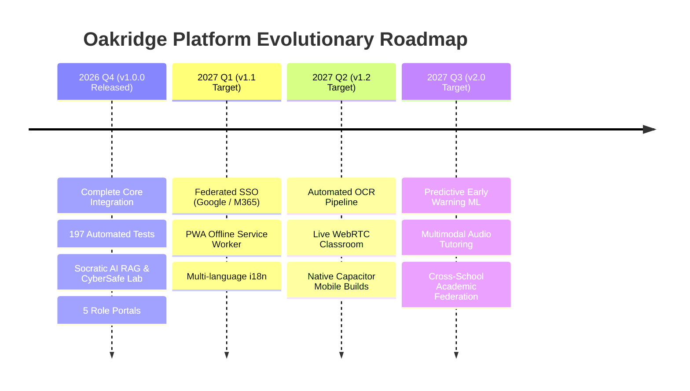

# Strategic Roadmap & Future Improvements

**Document Reference:** `docs/competition/FUTURE_IMPROVEMENTS.md`  
**Classification:** Competition Jury Technical Presentation Asset  
**Institution:** Oakridge Collegiate Academy  

---

## 1. Vision for Version 1.1 to Version 2.0

With the foundational integration and end-to-end security architecture validated in Version 1.0.0, the Oakridge engineering roadmap outlines targeted technological advancements scheduled for upcoming academic releases.

---

## 2. Strategic Enhancement Pillars

### 2.1 Enterprise Federated Single Sign-On (SSO / SAML 2.0 / OIDC)
- **Objective:** Integrate with existing district directory infrastructure (Google Workspace for Education and Microsoft 365 Education).
- **Implementation:** Implement OpenID Connect (OIDC) authentication endpoints in `lib/auth/`, allowing faculty and students to authenticate using single-click institutional credentials with automated SCIM user provisioning.

### 2.2 Offline PWA Caching & Native Mobile Packaging
- **Objective:** Deliver native store presences on iOS App Store and Google Play Store.
- **Implementation:** Implement Workbox-powered Progressive Web App service workers for local document caching and asset caching. Package the Next.js bundle into Capacitor.js cross-platform native containers for native push notification delivery.

### 2.3 Automated OCR & Vector Ingestion Microservice
- **Objective:** Automate indexing of scanned physical textbooks and handwritten teacher notes.
- **Implementation:** Deploy an asynchronous worker pipeline utilizing Tesseract.js / Google Cloud Vision OCR to extract text from uploaded images, compute embeddings, and insert vector chunks into `rag_document_chunks` without manual transcript entry.

### 2.4 Synchronous WebRTC Virtual Classrooms & Whiteboard
- **Objective:** Seamless distance learning during inclement weather or emergency closures.
- **Implementation:** Integrate peer-to-peer WebRTC video channels with canvas-based collaborative drawing surfaces, directly linking virtual rooms to existing timetable slots in `schoolStore`.

### 2.5 Predictive Early-Warning Analytics for Academic Intervention
- **Objective:** Detect scholars at risk of falling behind before midterm or final summative assessments.
- **Implementation:** Train logistic regression models analyzing attendance trends, homework submission timeliness, and diagnostic quiz accuracy to surface proactive alerts on the faculty dashboard.

### 2.6 Multimodal Socratic Voice Tutoring
- **Objective:** Enhance accessibility for visually impaired scholars and early language learners.
- **Implementation:** Leverage browser Web Speech API and WebAssembly neural text-to-speech models to enable conversational voice tutoring sessions in the AI Study Assistant.
